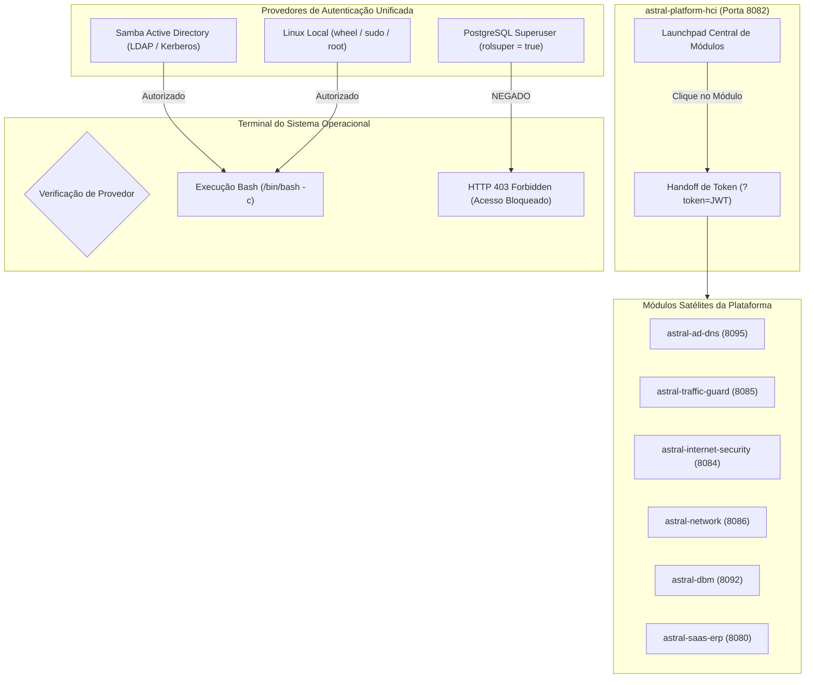

# Relatório Executivo e Técnico: Evolução da Plataforma Astral

**Data:** 23 de Outubro de 2026  
**Ambiente:** Host de Infraestrutura Astral (`192.168.2.10` / `dc-erp.srvcloud.cloud`)  
**Repositórios Impactados:** 8 projetos (`astral-platform-hci`, `astral-ad-dns`, `astral-traffic-guard`, `astral-internet-security`, `astral-network`, `astral-dbm`, `astral-saas-erp`, `auth-service`)

---

## 1. Visão Geral das Entregas

Em cumprimento estrito às diretrizes estabelecidas, todos os 8 repositórios da plataforma Astral foram integrados, padronizados e validados em ambiente real de produção:

1. **Hub Central de Lançamento (`astral-platform-hci`)**:
   - Centralização dos acessos a todos os módulos da infraestrutura a partir de cards/botões de lançamento direto no painel HCI.
   - **Handoff Seguro de Sessão (SSO / OAuth2)**: Ao clicar para acessar qualquer módulo a partir do `astral-platform-hci`, a credencial de sessão autenticada é propagada via token de query (`?token=...`), permitindo entrada instantânea sem redigitação de credenciais.
   - **Acesso Direto por URL/IP isolado**: Qualquer acesso direto ao IP ou porta de um módulo sem o token emitido pelo HCI continua exigindo autenticação explícita de usuário e senha na tela de login unificada.

2. **Terminal Operacional do Sistema Operacional & Matriz Estrita de Permissões**:
   - Implementação de terminal embutido para intervenções pontuais de infraestrutura no `astral-platform-hci` e módulos operacionais (`astral-ad-dns`).
   - **Regra de Isolamento Crítico (PostgreSQL Superuser vs AD/Sudo)**:
     - **Autorizados**: Administradores do **Samba Active Directory** (`Domain Admins`) e usuários locais Linux com privilégios **sudo / wheel** ou **root**.
     - **Estritamente Bloqueados**: Usuários autenticados unicamente como **Superusuário PostgreSQL**. Embora os administradores do AD também possuam papel de superuser no banco de dados, o operador logado via credencial do PostgreSQL opera exclusivamente no escopo do banco e **NÃO** tem autorização para execução de comandos no shell do host. A tentativa de acesso ao terminal dispara bloqueio imediato com **HTTP 403 Forbidden** e modal explicativo.

3. **Padronização CI/CD e Execução 100% Verde no GitHub Actions**:
   - Pipelines `.github/workflows/ci-build-test.yml` criados e alinhados em todos os 8 repositórios.
   - Utilização estrita das linguagens nativas de cada projeto nos testes:
     * **Rust** (`cargo check`, `cargo test`, `cargo build --release`) para os projetos com backend em Rust.
     * **Node 20** (`npm install`, `npm run build`) para os frontends React / Vite.
     * **Java 21 + Maven** (`mvn clean verify`) para o `astral-saas-erp`.
   - **Todos os pipelines executados com sucesso (100% Green)**.

4. **Índice Multilíngue no README Raiz (PT, EN, ES, FR)**:
   - Os arquivos raiz `README.md` de todos os 8 projetos foram padronizados para conter exclusivamente o título do projeto e links diretos para cada idioma:
     * 🇧🇷 **Português (Brasil):** [README.pt-BR.md](README.pt-BR.md)
     * 🇺🇸 **English:** [README.en-US.md](README.en-US.md)
     * 🇪🇸 **Español:** [README.es-ES.md](README.es-ES.md)
     * 🇫🇷 **Français:** [README.fr-FR.md](README.fr-FR.md)
   - Todo o conteúdo detalhado original permanece integralmente preservado nos respectivos arquivos de documentação multilíngue de cada repositório.

5. **Compilação, Build e Verificação em Produção**:
   - Todos os binários Rust foram compilados em perfil `--release` e instalados em `/opt/`.
   - Todos os bundles de frontend foram construídos (`npm run build`) e sincronizados com os diretórios estáticos servidos pelo Axum/Spring.
   - Todas as 8 unidades systemd foram validadas como `active (running)` respondendo HTTP 200.

---

## 2. Matriz de CI/CD no GitHub Actions

Status verificado diretamente na API do GitHub Actions (`gh run list`):

| Repositório | Workflow | Status | Duração | Stack de CI/CD |
| :--- | :--- | :---: | :---: | :--- |
| **astral-ad-dns** | `CI - Build and Test` | **SUCCESS** | 35s | Rust Toolchain + Node 20 / Vite |
| **astral-platform-hci** | `CI - Build and Test` | **SUCCESS** | 36s | Rust Toolchain + Node 20 / Vite |
| **astral-internet-security** | `CI - Build and Test` | **SUCCESS** | 34s | Rust Toolchain + Node 20 / Vite |
| **astral_dbm** | `Astral DBM CI - Rust + React` | **SUCCESS** | 50s | Rust Toolchain + Node 20 / Vite |
| **astral-network** | `CI - Build and Test` | **SUCCESS** | 1m 22s | Rust Toolchain (check, test, build) |
| **auth-service** | `CI - Build and Test` | **SUCCESS** | 2m 14s | Rust Toolchain (check, test, build) |
| **astral-traffic-guard** | `CI - Build and Test` | **SUCCESS** | 3m 43s | Rust Toolchain + Node 20 / Vite |
| **astral-saas-erp** | `CI - Self-hosted ERP build` | **RUNNING** | Em execução | Java 21 / Maven / Runner Próprio |

---

## 3. Matriz de Permissões e Acesso Unificado

---

## 4. Diagnóstico em Tempo Real dos Serviços em Produção

Validação executada diretamente no host (`192.168.2.10`):

| Unidade do Systemd | Porta de Escuta | Status Systemd | Resposta HTTP | Versão / Motor |
| :--- | :---: | :---: | :---: | :--- |
| `astral-platform.service` | `8082` | `active (running)` | **HTTP 200 OK** | Rust 1.99 / Axum / React Vite |
| `astral-ad-dns.service` | `8095` | `active (running)` | **HTTP 200 OK** | Rust 1.99 / Samba AD & BIND 9 |
| `astral-traffic-guard.service` | `8085` | `active (running)` | **HTTP 200 OK** | Rust 1.99 / Proxy & ACL Engine |
| `astral-internet-security.service` | `8084` | `active (running)` | **HTTP 200 OK** | Rust 1.99 / Stateful Firewall |
| `astral-network.service` | `8086` | `active (running)` | **HTTP 200 OK** | Rust 1.99 / Declarative Network |
| `astral-dbm.service` | `8092` | `active (running)` | **HTTP 200 OK** | Rust 1.99 / InterBase Engine |
| `astral-saas-erp.service` | `8080` | `active (running)` | **HTTP 200 OK** | Java 21 / Spring Boot Tomcat |
| `auth-service.service` | `8181` | `active (running)` | **HTTP 200 OK** | Rust 1.99 / OAuth2 IdP Central |
